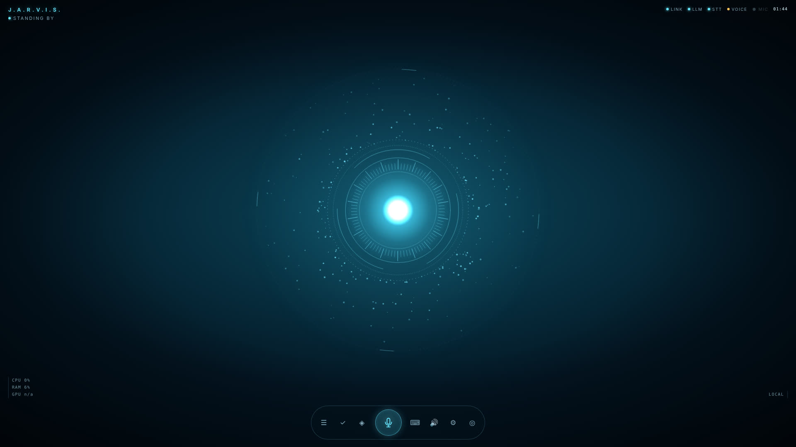

# J.A.R.V.I.S. — personal assistant (local-first)

A cinematic, voice-driven personal assistant that runs on **your own Windows 11 PC**: a glowing cyan
orb HUD, push-to-talk English/Hebrew speech (local faster-whisper), a local LLM (Ollama `qwen3:8b`)
with **approval-gated tools** for tasks and memories, a British-style voice via **Fish Audio**, and
secure iPhone access over **Tailscale Serve**.



> Status: see [`docs/PROGRESS.md`](docs/PROGRESS.md) for exactly what is verified and what still
> needs your keys/hardware. Nothing in the UI pretends to work when it doesn't.

## Requirements (Windows 11)
- Python **3.12 or 3.13** (python.org installer, "Add to PATH")
- Node.js **22 LTS** (or ≥ 20.19)
- [Ollama](https://ollama.com/download) and the model: `ollama pull qwen3:8b`
- Optional: NVIDIA driver (GPU telemetry, faster Ollama), a Fish Audio account + API key, Tailscale.

## Install → configure → run
```powershell
cd jarvis
powershell -ExecutionPolicy Bypass -File .\scripts\setup-windows.ps1   # venv, deps, UI build, .env
ollama pull qwen3:8b
notepad .env                     # optional now: FISH_API_KEY, FISH_REFERENCE_ID
powershell -ExecutionPolicy Bypass -File .\scripts\start-windows.ps1   # http://127.0.0.1:8787
powershell -ExecutionPolicy Bypass -File .\scripts\self-check.ps1      # health of each dependency
```
1. On first start the server console prints **`JARVIS first-run setup code: XXXX-XXXX-XXXX`**
   (also in `data\setup-code.txt`). Enter it in the browser with a username and a password (≥ 10 chars).
2. Check `http://127.0.0.1:8787/api/health` — each component reports `ready`, `not_configured` or `unavailable`.
3. Open **Diagnostics** (◎) for details and click *Load speech model now* (the first time downloads
   the Whisper model from Hugging Face).
4. Press and hold the **mic** (or hold **Space**) and say *"Jarvis, what do I have to do today?"* /
   *"ג'ארוויס, מה יש לי לעשות היום?"*. Tap once instead of holding for toggle mode; **Esc** cancels.

Manual run without scripts:
```powershell
cd jarvis\backend; python -m venv .venv; .\.venv\Scripts\pip install -e ".[stt,dev]"; .\.venv\Scripts\python -m app
cd jarvis\frontend; npm ci; npm run build          # or `npm run dev` → http://127.0.0.1:5173
```

## Voice (Fish Audio)
Put `FISH_API_KEY` in `.env` (never in chat/Git), restart, then **Settings → Voice**: search the library
(e.g. "british male"), audition with **▶ Test English / ▶ בדיקת עברית**, click **Use**. Details and voice
guidance: [`docs/VOICE_DESIGN.md`](docs/VOICE_DESIGN.md). Pricing: https://fish.audio/ (see their site;
not hard-coded here). The **spoken reply text** is sent to Fish Audio; microphone audio stays local.

## iPhone (Tailscale Serve)
See [`docs/SECURITY.md#remote-access-iphone`](docs/SECURITY.md#remote-access-iphone). Short version:
install Tailscale on PC and iPhone (same tailnet), set `APP_ALLOWED_HOSTS=<pc>.<tailnet>.ts.net` and
`APP_COOKIE_SECURE=true` in `.env`, restart, run `tailscale serve --bg localhost:8787`, open
`https://<pc>.<tailnet>.ts.net` in Safari → Share → *Add to Home Screen*. The PC must be on.

## Tests
```bash
cd backend && .venv/bin/python -m pytest -q && .venv/bin/ruff check app tests && .venv/bin/mypy app
cd frontend && npm run typecheck && npm run lint && npm test && npm run build
node frontend/scripts/screenshots.mjs   # browser E2E against a running server
```

## Docs
[SPEC](docs/SPEC.md) · [ARCHITECTURE](docs/ARCHITECTURE.md) · [ROADMAP](docs/ROADMAP.md) ·
[PROGRESS](docs/PROGRESS.md) · [SECURITY](docs/SECURITY.md) · [VOICE_DESIGN](docs/VOICE_DESIGN.md) ·
[API](docs/API.md) · [Visual reference notes](references/README.md)

"J.A.R.V.I.S." is used as a personal project name. The interface, artwork and code are original; no
film imagery, logos or voice clones are included.
